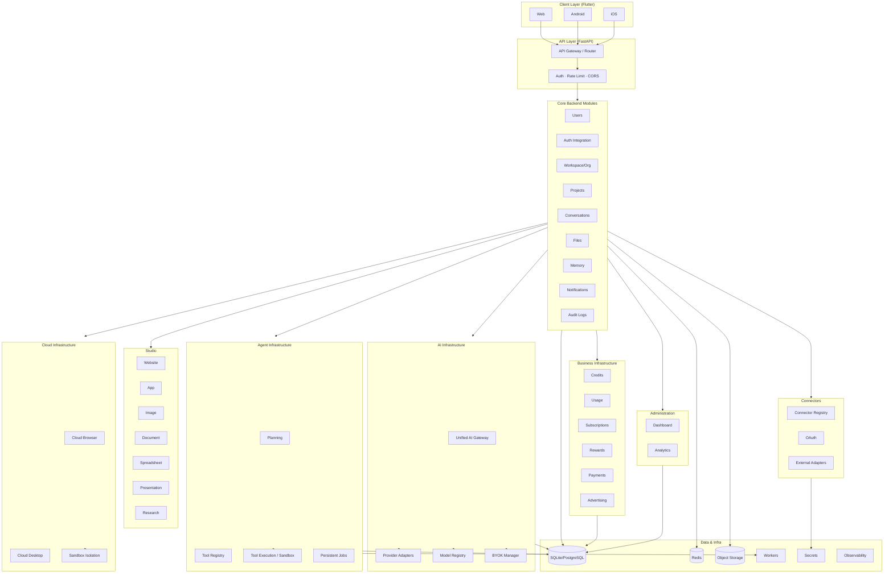
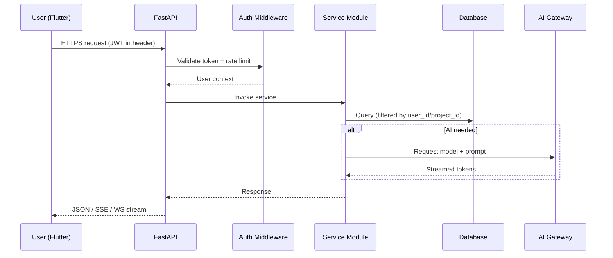
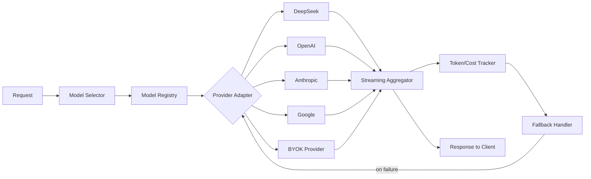
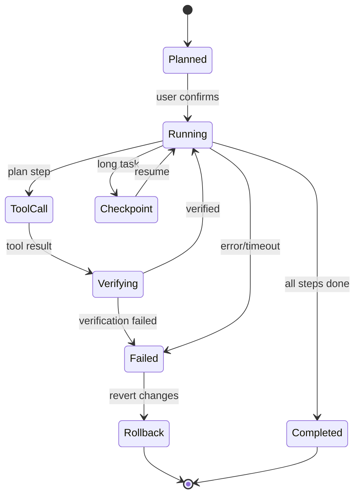
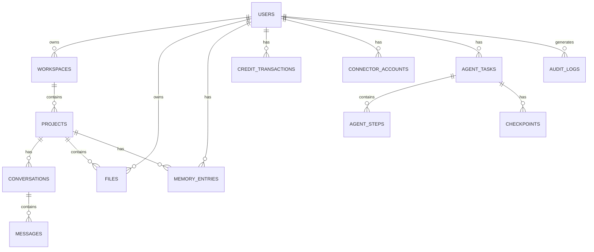
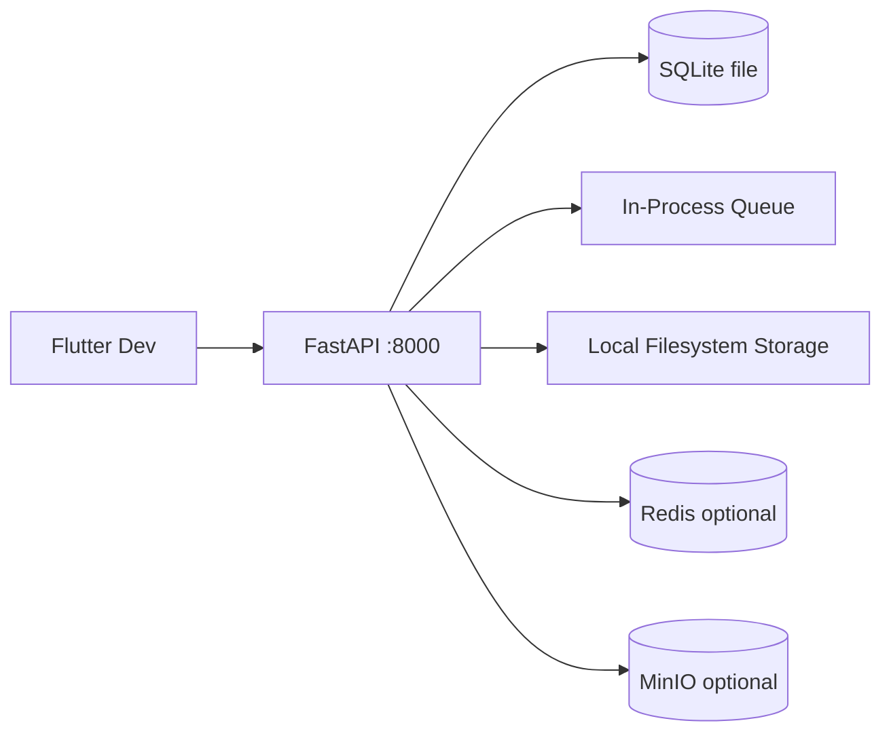
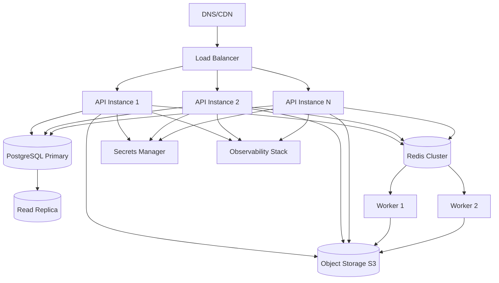
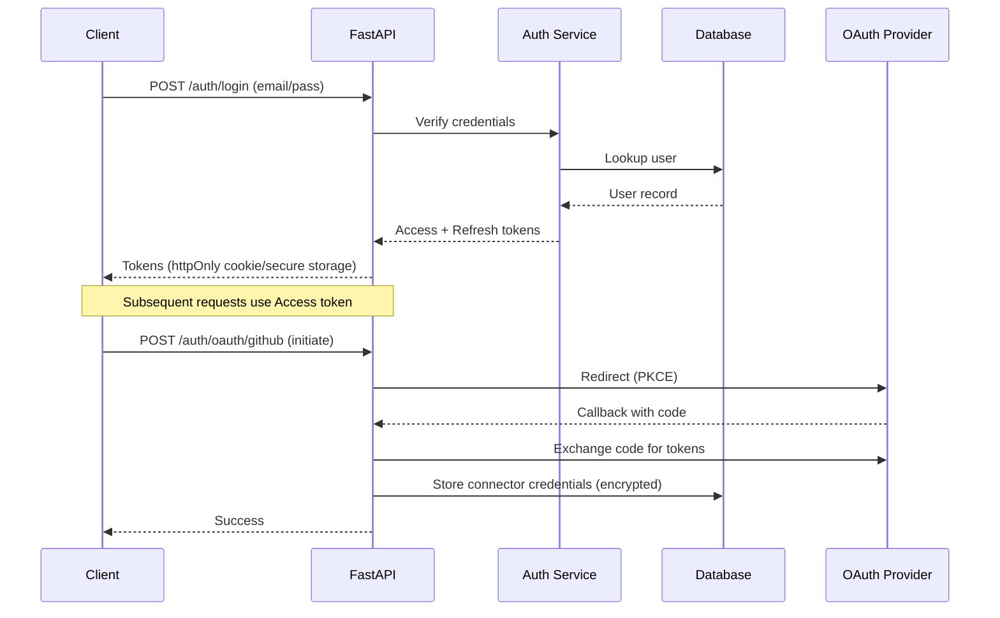
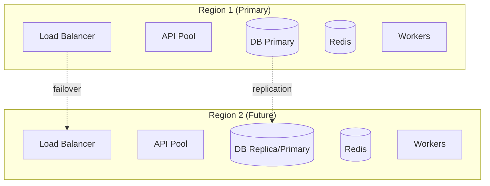

# SULY AI — System Architecture & Scalability Design
**PROMPT 02/35 — Complete Technical Architecture Report**

**الحالة:** هندسة وتوثيق فقط — لا تنفيذ، لا كتابة كود تطبيق، لا تعديل ملفات موجودة، لا تثبيت مكتبات.

---

## 1. Executive Summary

SULY AI هي منصة SaaS متعددة المستخدمين (multi-tenant) ومتعددة المنصات (Web/Android/iOS) مصممة كـ **Modular Monolith** في البداية، مع إمكانية تفكيك الوحدات إلى خدمات مستقلة (microservices) في مراحل لاحقة **بدون إعادة كتابة كاملة**. التصميم يركز على:

- **الأمان افتراضيًا (Security by Design):** عزل بيانات المستخدمين/المشاريع على مستوى الاستعلام، تشفير الأسرار، سجل تدقيق.
- **التشغيل المحلي أولاً (Local-First):** SQLite + خادم محلي + محولات (adapters) لكل خدمة خارجية، مع تقرير "غير متوفر" بوضوح عند عدم الاتصال.
- **القابلية للتوسع (Scalability):** من بيئة مطور واحد → إنتاج صغير → نمو → large scale، مع محفزات (triggers) واضحة لكل مرحلة.
- **عدم تعقيد مبكر (No Premature Complexity):** لا Redis/Load Balancer/DB managed إلا عند الحاجة (Stage 3+).
- **Supabase مؤجل:** كل خدمة (Auth/Storage/Realtime/RLS) لها محول مستقل، ولا تُعتبر Supabase "استبدال DB" بسيط.

**القرار الأساسي:** Modular Monolith (FastAPI) + Flutter client (shared) + SQLAlchemy ORM + SQLite/PostgreSQL + Redis (prod only) + Celery/ARQ workers + S3-compatible object storage.

## 2. Complete System Architecture

### 2.1 Logical Layers

```
┌─────────────────────────────────────────────────────────────┐
│  CLIENT LAYER (Flutter: Web / Android / iOS)                │
│  - UI, Navigation, State Mgmt, Auth Interface, Chat,       │
│    Workspace, Studios, Admin (gated)                        │
└──────────────────────┬──────────────────────────────────────┘
                       │ HTTPS / WSS (REST + WebSocket + SSE)
┌──────────────────────▼──────────────────────────────────────┐
│  API LAYER (FastAPI)                                        │
│  - Routing, Validation (Pydantic), Auth Middleware,         │
│    Authorization, Rate Limiting, Versioning (/v1),          │
│    Streaming, Error Handling, CORS                           │
└──────────────────────┬──────────────────────────────────────┘
                       │
┌──────────────────────▼──────────────────────────────────────┐
│  CORE BACKEND MODULES (Modular Monolith)                    │
│  Users · Auth Integration · Org/Workspace · Projects ·      │
│  Conversations · Files · Memory · Notifications · Audit Logs │
└──────────────────────┬──────────────────────────────────────┘
                       │
   ┌───────────────────┼───────────────────┬────────────────┐
   ▼                   ▼                   ▼                ▼
┌──────────┐   ┌──────────────┐   ┌──────────────┐   ┌──────────────┐
│ AI       │   │ Agent        │   │ Cloud        │   │ Business     │
│ Gateway  │   │ Infra        │   │ Infra        │   │ Infra        │
│ (adapters│   │ (planning,   │   │ (browser,    │   │ (credits,    │
│  registry)│   │  tools, jobs)│   │  desktop,    │   │  usage, subs)│
└────┬─────┘   └──────┬───────┘   └──────┬───────┘   └──────┬───────┘
     │                │                  │                  │
     ▼                ▼                  ▼                  ▼
┌─────────────────────────────────────────────────────────────┐
│  CONNECTORS · STUDIO · ADMINISTRATION                      │
└──────────────────────┬──────────────────────────────────────┘
                       │
┌──────────────────────▼──────────────────────────────────────┐
│  DATA & INFRA LAYER                                        │
│  - SQLAlchemy ORM · Alembic · SQLite/PostgreSQL             │
│  - Redis (prod) · Object Storage Abstraction · Workers     │
│  - Secrets Manager · Observability (logs/metrics/traces)    │
└─────────────────────────────────────────────────────────────┘
```

### 2.2 Key Principles
1. **Modular Monolith:** وحدات (modules) بحدود واضحة (packages) داخل تطبيق FastAPI واحد. كل وحدة لها domain models, services, repositories, routers.
2. **Adapter Pattern:** كل تبعية خارجية (DB، storage، queue، AI provider، connectors) خلف واجهة (interface) — يُمكن استبدالها دون تغيير منطق الأعمال.
3. **Stateless API:** instances FastAPI بدون حالة (stateless) — session في JWT/Redis، لتمكين horizontal scaling.
4. **Data Isolation:** فلترة تلقائية على `user_id`/`project_id`/`workspace_id` في كل repository (query-level), وليس فقط application-level.
5. **Explicit Unavailability:** إذا خدمة خارجية غير متصلة، API يُرجع خطأ واضح (503 + code) — never fake success.

---

## 3. Module Responsibility Matrix

| Module | Responsibility | Inputs | Outputs | Dependencies |
|--------|----------------|--------|---------|--------------|
| **Client (Flutter)** | UI, navigation, state, offline cache | User input, API responses | HTTP/WS requests, rendered UI | API Layer |
| **API Layer** | Routing, validation, auth, rate limit, versioning | HTTP requests | JSON/WS streams | Core modules |
| **User Mgmt** | Profiles, preferences, account lifecycle | Auth events | User entity | Auth Integration |
| **Auth Integration** | Login/signup, token issue/refresh, OAuth | Credentials, OAuth callbacks | Tokens, user identity | DB, Secrets |
| **Org/Workspace** | Multi-tenant orgs, workspaces, membership, roles | User actions | Workspace entities | User Mgmt |
| **Project Mgmt** | Projects, members, project-level settings | User actions | Project entities | Workspace |
| **Conversation Mgmt** | Chat threads, messages, history | Chat requests | Conversation entities | AI Gateway |
| **File Mgmt** | Upload/download, metadata, versioning | File bytes | File entities, URLs | Object Storage |
| **Memory Mgmt** | Personal & project memory (facts, embeddings) | Events/messages | Memory entries | DB, AI Gateway |
| **Notifications** | In-app/email/push notifications | Domain events | Notification records | Queue, Push adapter |
| **Audit Logs** | Immutable audit trail for sensitive ops | Domain events | Audit entries | DB |
| **AI Gateway** | Unified entry, routing, adapters, registry, streaming, fallback, token/cost, BYOK | Chat/agent requests | AI responses, usage records | Provider adapters, DB |
| **Agent Infra** | Planning, tool registry, permissions, execution, persistent jobs, checkpoints, verification, rollback, logs | Agent tasks | Task state, tool results | AI Gateway, Tool sandbox |
| **Cloud Infra** | Browser/desktop sessions, sandbox, remote interaction, resource limits | User requests | Session handles, streams | Container runtime, WS |
| **Business Infra** | Credits, usage, subscriptions, rewards, payments, ads, billing | Usage events, payments | Balance, plans, invoices | DB, Payment adapter |
| **Connectors** | Registry, OAuth, permissions, credential mgmt, external adapters | OAuth callbacks, API calls | Connector entities, external data | OAuth providers, Secrets |
| **Studio** | Website/App/Image/Doc/Spreadsheet/Presentation/Research generation | User prompts | Generated artifacts | AI Gateway, File Mgmt |
| **Administration** | Dashboard, user mgmt, analytics, cost, credits, monitoring, security controls | Admin actions | Admin views, reports | All modules |

---

## 4. Architecture Diagrams (Mermaid)

### 4.1 Complete System Architecture


### 4.2 Frontend-to-Backend Request Flow


### 4.3 AI Gateway and Provider Flow


### 4.4 Agent Execution Lifecycle


---

### 4.5 Background Job Architecture
```mermaid
flowchart TB
  subgraph Dev["Local Dev"]
    IQ[In-Process Queue (asyncio)] --> IW[In-Process Worker]
  end
  subgraph Prod["Production"]
    API[API Instances] -->|enqueue| RD[(Redis)]
    RD --> W1[Worker 1]
    RD --> W2[Worker 2]
    RD --> WN[Worker N]
    W1 & W2 & WN --> DB[(PostgreSQL)]
    W1 & W2 & WN --> OS[(Object Storage)]
  end
  API -->|dev mode| IQ
```

### 4.6 Data Storage Architecture


### 4.7 Local Development Deployment


### 4.8 Production Deployment


### 4.9 Authentication & Authorization Flow


### 4.10 Future Horizontal Scaling Topology


---

## 5. Data Flow and API Contracts

### 5.1 Communication Methods
- **REST (HTTPS):** CRUD, auth, file metadata, credits, admin, connectors config.
- **WebSocket (WSS):** Real-time chat, agent progress, cloud browser/desktop streaming, notifications.
- **SSE:** Token streaming for AI responses (alternative to WS; WS preferred for bidirectional).
- **Internal (in-process):** Module calls within monolith (Python function calls / service interfaces).

### 5.2 High-Level API Contract (Examples)

#### Authentication
- `POST /v1/auth/register` — body: `{email, password, locale}` → `{user_id, access_token, refresh_token}`
- `POST /v1/auth/login` — body: `{email, password}` → tokens
- `POST /v1/auth/refresh` — body: `{refresh_token}` → new access token
- `POST /v1/auth/logout` — revoke refresh token
- `GET /v1/auth/oauth/{provider}/authorize` → redirect URL
- `GET /v1/auth/oauth/{provider}/callback` → tokens

#### Chat
- `POST /v1/chat/completions` — body: `{conversation_id?, model, messages[], stream}` → SSE stream of tokens / JSON
- `GET /v1/conversations` → list
- `GET /v1/conversations/{id}/messages` → paginated messages

#### Files
- `POST /v1/files/upload` (multipart) → `{file_id, url}`
- `GET /v1/files/{id}` → metadata + signed URL

#### Agents
- `POST /v1/agents/tasks` — body: `{goal, tools_allowed[]}` → `{task_id}`
- `GET /v1/agents/tasks/{id}` → status, steps, checkpoints
- `POST /v1/agents/tasks/{id}/cancel` → cancel

#### Credits
- `GET /v1/credits/balance` → `{balance, currency}`
- `GET /v1/usage` → usage breakdown

#### Admin
- `GET /v1/admin/users` (admin only) → paginated users
- `GET /v1/admin/cost-analytics` → cost reports

### 5.3 Request/Response Conventions
- All responses: `{data, error, meta}` envelope.
- Errors: `{error: {code, message, details}}` with HTTP status.
- Pagination: `?page=&page_size=` with `meta: {total, page, page_size}`.
- Versioning: `/v1/` prefix; breaking changes → `/v2/`.
- Idempotency: `Idempotency-Key` header for payments/credits operations.

### 5.4 Error Handling
- Global exception handler in FastAPI → unified JSON.
- Validation errors (422) with field-level details.
- Auth errors (401/403) with clear codes.
- Rate limit (429) with `Retry-After`.
- Service unavailable (503) when external dependency down — never fake success.

---

## 6. Database Architecture

### 6.1 Development vs Production
- **Dev:** SQLite (file-based, zero config), SQLAlchemy ORM, Alembic migrations (run locally).
- **Prod:** PostgreSQL (managed or self-hosted), same SQLAlchemy models, Alembic migrations applied in CI/CD.

### 6.2 ORM & Migrations
- **SQLAlchemy 2.x** with async support (`asyncpg` for PG, `aiosqlite` for SQLite).
- **Alembic** for schema migrations; migrations tested in CI against both SQLite and PostgreSQL.
- **Repository pattern:** all DB access through repository classes → enables swapping DB without business logic changes.

### 6.3 Core Tables (High-Level)
- `users`, `sessions`, `refresh_tokens`
- `organizations`, `workspaces`, `workspace_members`
- `projects`, `project_members`
- `conversations`, `messages`
- `files`, `file_versions`
- `memory_entries` (with vector column reserved for future pgvector)
- `agent_tasks`, `agent_steps`, `checkpoints`, `execution_logs`
- `credit_transactions`, `usage_records`, `subscriptions`, `plans`, `rewards`
- `connector_accounts`, `connector_credentials` (encrypted)
- `audit_logs`
- `models_registry`, `provider_configs`

### 6.4 Indexing & Query Optimization
- Indexes on all foreign keys and filter columns (`user_id`, `project_id`, `workspace_id`, `created_at`).
- Composite indexes for common query patterns (e.g., `(user_id, created_at)`).
- Pagination via cursor-based for large tables (messages, audit logs).
- N+1 prevention via `selectinload`/`joinedload`.
- Read replicas for analytics (Stage 4).

### 6.5 Connection Pooling
- SQLAlchemy pool: `pool_size`, `max_overflow`, `pool_recycle` tuned per environment.
- Dev: small pool; Prod: larger pool with health checks.

### 6.6 Data Isolation
- Every repository method accepts `user_id`/`project_id`/`workspace_id` context and filters.
- Row-Level Security (RLS) reserved for Supabase stage (future) — not assumed now.
- Admin queries bypass via explicit admin context with audit logging.

### 6.7 Backups & DR
- Dev: file copy of SQLite.
- Prod: automated daily backups (pg_dump / managed backup), point-in-time recovery, tested restore procedure.

---

## 7. AI Gateway Architecture

### 7.1 Unified AI Gateway
- Single entry point: `AIGateway.request(model, messages, tools, stream, user_context)`.
- Responsibilities: model selection, provider routing, fallback, streaming aggregation, token/cost tracking, BYOK resolution, rate limiting per user.

### 7.2 Provider Adapters
- Interface: `ProviderAdapter.complete()`, `stream()`, `list_models()`, `health_check()`.
- Implementations: DeepSeek, OpenAI, Anthropic, Google Gemini, + BYOK (user-supplied key).
- Each adapter normalizes request/response to internal schema.

### 7.3 Model Registry
- DB table: `models_registry` with fields: `provider`, `model_id`, `capabilities` (text/image/code/research), `cost_per_1k_input`, `cost_per_1k_output`, `context_window`, `enabled`, `fallback_model`.
- Admin can enable/disable models and adjust pricing.

### 7.4 Model Selection
- Default model per user/plan; user can override; agent can specify.
- Capability-based routing (e.g., image gen → image-capable model).

### 7.5 Streaming
- SSE for token streaming; WebSocket for bidirectional (tool calls mid-stream).
- Backpressure handling; client disconnect detection.

### 7.6 Fallback Handling
- On provider error/timeout/rate-limit → retry with exponential backoff → fallback to alternate model/provider.
- Circuit breaker per provider (open after N failures, half-open after cooldown).

### 7.7 Token & Cost Tracking
- Every request logs: `input_tokens`, `output_tokens`, `cost_usd`, `model`, `user_id`, `project_id`, `timestamp`.
- Aggregated into `usage_records` and `credit_transactions`.

### 7.8 BYOK
- User supplies API key → encrypted at rest (AES-256-GCM with KMS-derived key) → used only for that user's requests → never logged in plaintext.

### 7.9 Provider Availability Management
- Health checks (periodic + on-demand); admin dashboard shows provider status; auto-disable unhealthy providers with alert.

---

## 8. Agent Architecture

### 8.1 Agent Planning
- `PlanningEngine.plan(goal, context, allowed_tools)` → list of steps with tool assignments.
- Uses AI Gateway to generate plan; plan stored in `agent_tasks` + `agent_steps`.

### 8.2 Tool Registry
- Tools registered with: `name`, `description`, `input_schema`, `required_permissions`, `timeout`, `idempotent`.
- Core tools: web search, file read/write, code execution (sandboxed), browser automation, memory read/write, connector calls.

### 8.3 Permission System
- Each tool requires explicit permission; agent task declares `allowed_tools`.
- User must approve high-risk tools (e.g., file delete, code exec, external API calls).
- Permissions scoped per task; no implicit escalation.

### 8.4 Tool Execution
- `ToolExecutor.run(tool, input, context)` → isolated execution with timeout, resource limits, logging.
- Sandboxed: no network except allowlisted; no filesystem except scratchpad; CPU/memory limits.

### 8.5 Persistent Jobs
- Long-running tasks stored in DB + Redis queue; survive API restarts.
- Workers pick up jobs; state persisted after each step.

### 8.6 Checkpoints
- After each significant step, save checkpoint (state snapshot) to DB.
- Resume from last checkpoint on failure/restart.

### 8.7 Verification
- `Verifier.verify(output, criteria)` → pass/fail + feedback; on fail, re-plan or abort.

### 8.8 Rollback
- For mutating tools (file writes, DB changes), record undo operations; on failure/abort, execute rollback in reverse order.

### 8.9 Execution Logs
- Every tool call logged: input, output, duration, status, error — stored in `execution_logs` for audit/debug.

---

## 9. Cloud Infrastructure Architecture (Browser & Desktop)

### 9.1 Abstraction
- `CloudBrowserService` and `CloudDesktopService` are **independent** interfaces with separate implementations.
- Neither depends on the other's internal implementation; they share only common infra (sandbox runtime, WS streaming, session mgmt).

### 9.2 Cloud Browser
- Headless browser (Playwright/Chromium) in isolated container.
- Streams viewport via WebRTC/WebSocket to client; accepts input events (mouse/keyboard).
- Automation API: navigate, click, type, extract, screenshot.

### 9.3 Cloud Desktop
- Lightweight desktop environment (e.g., Xvfb + window manager) in container.
- Remote interaction via VNC/RDP over WebSocket or WebRTC.
- Used for desktop-only tasks (legacy apps, GUI automation).

### 9.4 Isolated Execution Environments
- Each session = separate container with: non-root user, read-only root FS, limited CPU/memory, network egress allowlist, ephemeral storage (cleaned on session end).

### 9.5 Remote Interaction
- Low-latency input streaming; adaptive quality (resolution/bitrate) based on bandwidth.

### 9.6 Session Management
- Sessions have TTL; auto-terminate on inactivity; max concurrent sessions per user/plan.

### 9.7 Resource Limits
- Per-session CPU/memory/time caps; global pool limits; queue when at capacity.

---

## 10. Security Architecture

### 10.1 Threat Model Summary
| Asset | Threats | Mitigations |
|-------|---------|-------------|
| User accounts | Credential stuffing, takeover | Strong password policy, 2FA (future), rate limiting, breach detection |
| Sessions/tokens | Theft, replay | Short-lived access tokens, refresh rotation, httpOnly/secure cookies, device binding (future) |
| User data | IDOR, cross-user access | Query-level filtering, ownership checks, tests |
| Project files | Malicious upload, path traversal | Type/size validation, virus scan, random names, storage outside webroot, signed URLs |
| API keys (platform) | Leakage | Secrets manager, never in code/logs, rotation |
| BYOK credentials | Plaintext storage | AES-256-GCM encryption at rest, KMS, never logged |
| AI agents | Unauthorized tool exec, prompt injection | Permission system, sandbox, verification, audit logs |
| Browser automation | SSRF, data exfil | Network allowlist, container isolation, no host access |
| Cloud Desktop | Escape, resource abuse | Container isolation, limits, ephemeral FS |
| GitHub/OAuth connectors | Token theft, scope creep | PKCE, minimal scopes, encrypted storage, revocation |
| Credits/payments | Manipulation, double-spend | Atomic transactions, idempotency, audit trail, reconciliation |
| Admin privileges | Privilege escalation | Separate admin auth, least privilege, MFA, audit logs |

### 10.2 Protection Against Specific Attacks
- **IDOR:** Ownership checks in every repository/service; automated tests.
- **SSRF:** URL allowlist, block private IP ranges, DNS rebinding protection.
- **SQL Injection:** Parameterized queries via ORM; no raw SQL with user input.
- **XSS:** Output encoding, CSP headers, no `dangerouslySetInnerHTML` equivalents.
- **CSRF:** SameSite cookies, CSRF tokens for state-changing ops (web).
- **Unauthorized tool execution:** Permission system + sandbox + user approval.
- **Privilege escalation:** Role checks at API + service layer; admin routes segregated.
- **Credit manipulation:** Atomic DB transactions, idempotency keys, audit logs, reconciliation jobs.
- **Resource exhaustion:** Rate limiting (per user/IP), quotas, timeouts, circuit breakers.
- **Malicious file uploads:** Validation, scanning, sandboxed processing, size limits.
- **Cross-user data access:** Tenant isolation tests, query filtering.

### 10.3 Secrets Management
- Dev: `.env` (gitignored) with local keys.
- Prod: Cloud secrets manager (AWS Secrets Manager / GCP Secret Manager / Vault).
- Never commit secrets; pre-commit secret scanning.

---

## 11. Local vs Production Architecture

### 11.1 Local Development
- SQLite (file DB)
- FastAPI on localhost:8000
- Flutter dev (web/mobile emulator)
- In-process queue (asyncio) for simple tests
- Optional: Redis (Docker), MinIO (Docker)
- Local filesystem object storage adapter
- `.env` for secrets
- Mock adapters for external services (clearly labeled "unavailable" if not configured)

### 11.2 Production
- PostgreSQL (managed or self-hosted)
- Multiple FastAPI instances behind load balancer
- Redis-backed queues + caching
- Durable workers (Celery/ARQ)
- External object storage (S3/R2/GCS)
- Secrets manager
- Monitoring + backups + DR

### 11.3 Adapter Interface Rule
Every external dependency implements an interface:
- `DatabaseAdapter`, `CacheAdapter`, `QueueAdapter`, `StorageAdapter`, `AIProviderAdapter`, `PaymentAdapter`, `PushAdapter`, `OAuthAdapter`.
- Dev uses local/mock implementation; prod uses real implementation.
- If a real service is not configured, the app reports "unavailable" — never simulates success.

### 11.4 Local vs Prod Auth Separation
- Dev: simple JWT with local secret; optional dev-only login bypass (clearly gated by env flag `DEV_AUTH_BYPASS=true`, disabled in prod).
- Prod: full auth flow; no custom crypto; standard JWT (RS256/ES256) with key rotation.

---

## 12. Scalability Roadmap

### Stage 1 — Local Development
- **What:** Single dev machine, SQLite, in-process queue, local storage.
- **Triggers to next:** First deployable artifact needed; need real users.

### Stage 2 — Initial Production
- **What:** Single API instance, managed PostgreSQL, basic monitoring, backups, controlled AI usage, S3 storage, Redis (single node) for queues.
- **Triggers to next:** CPU/memory saturation, DB connection exhaustion, queue backlog, latency degradation, user growth.

### Stage 3 — Growth
- **What:** Multiple API instances behind LB, Redis cluster, worker pool, DB indexing/optimization, read replicas, improved monitoring/alerting, CDN for static assets.
- **Triggers to next:** Monolith becomes bottleneck for specific domains (e.g., agent execution, cloud browser), DB write contention, regional latency needs.

### Stage 4 — Large Scale
- **What:** Extract specific modules to independent services (agent engine, cloud browser, AI gateway) when justified; distributed job processing; DB sharding/partitioning if needed; regional infrastructure; HA + DR with multi-region.
- **Triggers:** Measured bottlenecks, cost optimization, team scaling.

**Principle:** Do not extract services before measuring a bottleneck. Modular monolith first.

---

## 13. Performance and Bottleneck Analysis

### 13.1 Expected Bottlenecks
1. **AI Provider latency/cost:** External LLM calls dominate response time; mitigated by streaming, caching (prompt cache), fallback, token limits.
2. **Database writes under load:** Agent tasks + usage tracking generate many writes; mitigated by batching, async writes, connection pooling, indexing.
3. **WebSocket connections:** Many concurrent real-time connections; mitigated by stateless instances + Redis pub/sub for cross-instance broadcast.
4. **Cloud browser/desktop sessions:** Heavy resource usage; mitigated by session limits, pooling, queueing.
5. **File uploads:** Large files block; mitigated by presigned URLs (direct-to-storage), async processing.
6. **Agent execution:** Long-running, resource-intensive; mitigated by worker pool, checkpoints, timeouts.

### 13.2 Caching Strategy
- Redis (prod) / in-memory (dev): session cache, model registry cache, rate-limit counters, user profile cache.
- TTL-based invalidation; explicit invalidation on updates.
- AI prompt caching (provider-side where supported) + application-side response cache for deterministic queries.

### 13.3 Rate Limiting & Abuse Protection
- Per-user and per-IP rate limits (token bucket) at API layer.
- Per-plan quotas (requests/day, tokens/day, agent tasks/day).
- Abuse detection: anomaly detection on usage patterns; auto-throttle.

---

## 14. Architectural Decision Records (ADRs)

### ADR-01: Modular Monolith over Microservices initially
- **Problem:** Need scalability without premature complexity.
- **Options:** Microservices from start vs Modular Monolith.
- **Selected:** Modular Monolith.
- **Advantages:** Simpler deployment, lower cost, easier debugging, modules can be extracted later.
- **Disadvantages:** Single deployable unit; scaling is coarse-grained initially.
- **Scalability:** Horizontal scaling of whole app; extract modules when measured bottlenecks.
- **Security:** Single trust boundary easier to secure initially.
- **Cost:** Lower infra cost.
- **Change condition:** When a module's scaling needs diverge significantly (e.g., agent engine) or team grows beyond monolith coordination.

### ADR-02: Flutter for all clients (Web/Android/iOS)
- **Problem:** Multi-platform with single codebase.
- **Options:** Native (Swift/Kotlin) + Web (React) vs Flutter vs React Native.
- **Selected:** Flutter.
- **Advantages:** Single codebase, Dart, good performance, strong Web support improving.
- **Disadvantages:** Web has limitations (some native plugins); larger bundle size.
- **Scalability:** UI layer scales via CDN; backend handles load.
- **Security:** Standard mobile/web security; careful with token storage.
- **Cost:** One team, one codebase.
- **Change condition:** If Flutter Web performance becomes unacceptable for a key flow.

### ADR-03: Flutter State Management — Riverpod (recommended)
- **Problem:** Need scalable, testable state management across platforms.
- **Options:** Provider, Bloc, Riverpod.
- **Selected (recommended):** Riverpod.
- **Advantages:** Compile-time safety, no BuildContext dependency, easy testing, good for complex async.
- **Disadvantages:** Learning curve; verbosity.
- **Alternatives:** Bloc (more boilerplate, good for event-driven), Provider (simpler, less scalable).
- **Change condition:** Team preference / complexity needs.

### ADR-04: FastAPI + REST + WebSockets/SSE
- **Problem:** API communication strategy.
- **Options:** REST only, GraphQL, gRPC, REST+WS.
- **Selected:** REST + WebSockets + SSE.
- **Advantages:** FastAPI native async, OpenAPI docs, WS for real-time, SSE for streaming.
- **Disadvantages:** Multiple protocols to maintain.
- **Change condition:** If a unified protocol (e.g., gRPC) becomes justified by performance.

### ADR-05: SQLAlchemy + Alembic (SQLite dev / PostgreSQL prod)
- **Problem:** DB abstraction for dev/prod parity.
- **Options:** Django ORM, Tortoise, SQLAlchemy.
- **Selected:** SQLAlchemy + Alembic.
- **Advantages:** Async support, mature, supports both SQLite and PG, migration tooling.
- **Disadvantages:** Alembic complexity; PG-specific features (JSONB, RLS) need care.
- **Change condition:** If Supabase RLS becomes primary (future stage).

### ADR-06: Redis for prod (caching + queues); in-process for dev
- **Problem:** Caching and job queue infrastructure.
- **Options:** Redis, RabbitMQ, in-memory, DB-backed queues.
- **Selected:** Redis (prod) / in-process (dev).
- **Advantages:** Unified (cache + queue), mature, horizontal scaling.
- **Disadvantages:** Extra infra in prod; dev/prod parity gap.
- **Change condition:** If Redis becomes cost/complexity burden → evaluate managed Redis or DB-backed queues.

---

### ADR-07: Object Storage Abstraction (local FS dev / S3-compatible prod)
- **Problem:** File storage across environments.
- **Options:** Direct S3, local FS, MinIO.
- **Selected:** Abstraction with local FS (dev) / S3-compatible (prod, MinIO for local testing).
- **Advantages:** Dev without cloud; prod scalable; MinIO for local S3 parity.
- **Disadvantages:** Abstraction overhead.
- **Change condition:** If direct cloud storage simplifies without harming dev.

### ADR-08: Background Workers — Celery or ARQ (prod); in-process (dev)
- **Problem:** Long-running tasks (agents, files, notifications).
- **Options:** Celery, ARQ, RQ, Dramatiq.
- **Selected (recommended):** ARQ (async-native, Redis-backed) for prod; in-process for dev. Celery as alternative if ecosystem needs.
- **Advantages:** ARQ async-native, simpler than Celery; Celery if heavy ecosystem needed.
- **Disadvantages:** ARQ smaller ecosystem.
- **Change condition:** If Celery-specific features (beat scheduler, etc.) needed.

### ADR-09: Admin Interface — Web-only (Flutter Web route, gated)
- **Problem:** Admin dashboard architecture.
- **Options:** Separate admin app, embedded in main app, separate service.
- **Selected:** Embedded in main Flutter app with role-gated routes (admin-only screens) + dedicated admin API endpoints.
- **Advantages:** Single codebase; reuse design system; lower maintenance.
- **Disadvantages:** Admin bundle shipped to all clients (mitigated by code splitting/lazy loading).
- **Change condition:** If admin needs become complex enough to warrant separate app.

### ADR-10: Deployment — Containerized (Docker) + orchestration (future K8s)
- **Problem:** Deployment strategy.
- **Options:** VM, PaaS (Render/Fly), Docker+Compose, Kubernetes.
- **Selected:** Docker containers; Docker Compose for small scale; Kubernetes/managed container service when scaling demands.
- **Advantages:** Portable, reproducible, gradual complexity.
- **Disadvantages:** K8s complexity deferred.
- **Change condition:** When horizontal scaling/HA demands orchestration.

### ADR-11: Supabase deferred — per-service adapters
- **Problem:** Supabase integration timing.
- **Options:** Use Supabase from start vs defer.
- **Selected:** Defer; design adapters for Auth/Storage/Realtime/RLS individually.
- **Advantages:** Avoid lock-in; keep local-first; integrate only when needed.
- **Disadvantages:** More upfront abstraction.
- **Change condition:** When managed auth/storage/realtime justify the integration cost.

---

## 15. Risks and Mitigation Plan

| Risk | Impact | Mitigation |
|------|--------|------------|
| Premature microservices | High cost/complexity | Modular monolith + extract only on measured bottlenecks |
| AI provider outage/cost spike | Service degradation | Fallback routing, circuit breaker, usage caps, cost alerts |
| Data leakage (IDOR) | Critical | Query-level isolation, automated tests, security review |
| Agent sandbox escape | Critical | Container isolation, non-root, network allowlist, resource limits, audit |
| SQLite→PG migration bugs | High | Alembic tested on both; integration tests; staged rollout |
| WebSocket scaling issues | Medium | Redis pub/sub, stateless instances |
| Credit manipulation | High | Atomic transactions, idempotency, audit, reconciliation |
| Cost overrun (infra) | Medium | Stage-gated scaling, monitoring, budgets |
| Supabase lock-in | Medium | Per-service adapters, deferred integration |
| Flutter Web limitations | Medium | Progressive enhancement, native fallbacks where needed |

---

## 16. Recommended Repository Architecture

```
suly-ai/
├── apps/
│   ├── flutter_app/          # Flutter (Web/Android/iOS)
│   │   ├── lib/
│   │   │   ├── core/         # shared utilities, theme, routing
│   │   │   ├── features/     # feature modules (chat, agents, studio, ...)
│   │   │   └── data/         # repositories, API clients
│   │   └── pubspec.yaml
│   └── admin_web/            # (optional, if separate admin app later)
├── backend/
│   ├── app/
│   │   ├── main.py
│   │   ├── core/             # config, security, deps
│   │   ├── modules/          # domain modules (users, chat, agents, ...)
│   │   │   └── <module>/
│   │   │       ├── router.py
│   │   │       ├── service.py
│   │   │       ├── repository.py
│   │   │       ├── models.py
│   │   │       └── schemas.py
│   │   ├── infra/            # adapters (db, cache, queue, storage, ai)
│   │   └── workers/          # background job handlers
│   ├── alembic/
│   ├── tests/
│   ├── pyproject.toml
│   └── requirements.txt
├── docs/
│   ├── architecture/
│   └── adrs/
├── infra/
│   ├── docker/
│   └── k8s/ (future)
├── scripts/
└── README.md
```

---

## 17. Questions Requiring Owner Approval

1. **Flutter state management:** Riverpod (recommended) vs Bloc vs Provider?
2. **Background workers:** ARQ (recommended) vs Celery?
3. **Initial platform priority:** Flutter Web first vs all platforms in parallel?
4. **Default AI provider:** DeepSeek vs OpenAI vs Anthropic for first integration?
5. **Production database:** Self-hosted PostgreSQL vs managed (RDS/Cloud SQL) vs Supabase (deferred)?
6. **Admin interface:** Embedded in main app (recommended) vs separate admin app?
7. **Deployment target:** PaaS (Render/Fly) vs VPS (Docker Compose) vs Kubernetes (later)?
8. **Cloud browser/desktop:** Build in-house (containers) vs use managed service (e.g., Browserless) initially?
9. **Monetization first:** Credits-only vs subscriptions from launch?
10. **Observability stack:** OpenTelemetry + Grafana (recommended) vs vendor (Datadog/Sentry)?

---

## 18. Final Approval Gate

- ✅ **Architecture satisfies scalability requirements** for the stated stages (local → initial prod → growth → large scale) with clear triggers and no premature complexity.
- ✅ **Modular Monolith** chosen with extraction path; no rewrite required later.
- ✅ **Security by design** with threat model and specific mitigations.
- ✅ **Local-first** with clear dev/prod separation and adapter interfaces.
- ✅ **Supabase deferred** with per-service adapter design.
- ⚠️ **Unresolved decisions** listed in Section 17 require owner input before PROMPT 03.
- ⚠️ **Expensive infra (Stage 3+):** Redis cluster, managed DB, worker pool, K8s — only when triggered by measured bottlenecks.

**STOP:** Awaiting owner's explicit approval. Do not proceed to PROMPT 03 without permission.

---

### 📋 ملاحظة ختامية
- هذا التقرير **هندسة وتوثيق فقط** — لم أُنشئ أي ملف تنفيذي، لم أعدّل أي ملف تطبيق، لم أثبّت أي مكتبة، لم أتصل بأي خدمة.
- الأسئلة (Section 17) تحتاج قراركم قبل الانتقال إلى PROMPT 03 (Repository Structure).
- بعد الموافقة، سأقوم بحفظ الملف ورفعه إلى GitHub (commit + push) كما في PROMPT 01.

---

---

# SULY AI — PROMPT 02 REVISION
## Architecture Corrections, Final Decisions & Integration Strategy

**المصدر:** PROMPT 02/35 REVISION (Owner's Implementation Strategy + Confirmed Decisions + Required Corrections)
**النطاق:** توثيق وهندسة فقط — لا كود، لا ملفات تطبيق، لا تثبيت، لا خدمات خارجية.

---

## R0. Owner's Implementation Strategy

**الاستراتيجية المعتمدة:** بناء الأساس الداخلي (internal foundation) أولاً، ثم ربط الخدمات الخارجية (via Manus) لاحقاً، ثم اختبار في بيئة حقيقية.

- بناء: البنية الداخلية، الوحدات، منطق الأعمال، الواجهات (interfaces)، العقود (contracts)، نقاط التكامل (integration points).
- تحضير: محولات (adapters) لمزودي/خدمات خارجية.
- **عدم** إنشاء حسابات خارجية، **عدم** الحصول على API Keys، **عدم** تكوين خدمات مدفوعة، **عدم** ربط مزودين إنتاجيين في هذه المرحلة.
- **عدم** تنفيذ تكاملات وهمية (fake) تدّعي أنها حقيقية.
- التطوير/الاختبار المحلي مسموح، لكن الخدمات المحاكاة (simulated) يجب أن تُعلَّم بوضوح كـ development/test adapters.
- ميزة غير مربوطة يجب أن تُبلّغ بوضوح أن تكاملها "غير مُكوَّن" (not configured).
- بعد بناء الأساس، يستخدم المالك Manus لربط الخدمات الحقيقية وإجراء اختبارات بيئة حقيقية.
- جعل التكامل اللاحق سهلاً دون إعادة كتابة معمارية كبرى.

**هذا ليس ترخيصاً لإهمال الهندسة.** صمّم واجهات التكامل الآن؛ أخّر الاتصالات الفعلية.

---

## R1. Final Confirmed Architecture Decisions (Approved Defaults)

1. **Architecture:** Modular Monolith initially, clear module boundaries allowing future extraction to independent services.
2. **Frontend:** Flutter + Dart. Prioritize Flutter Web first while preserving Android/iOS compatibility.
3. **State Management:** Riverpod.
4. **Backend:** Python + FastAPI.
5. **Database:** SQLite (local dev) + PostgreSQL (production).
6. **AI Providers:** No single default. Unified AI Gateway with multiple provider adapters.
7. **Background Jobs:** ARQ + Redis as planned persistent job-processing architecture. In-memory/simplified local adapter is **test-only**, never production-safe.
8. **Admin:** Initially part of main app; all admin permissions enforced by backend. Architecture ready for separate admin interface later.
9. **Deployment:** Docker-compatible first. VPS/PaaS selectable later by cost/requirements. Kubernetes not an initial requirement.
10. **Cloud Browser/Desktop:** Define interfaces, lifecycle, security boundaries, execution contracts now. Defer real infrastructure and external execution services.
11. **Monetization:** Design credit system + prepare subscription support. Do not connect payment providers now.
12. **Observability:** Structured logs, metrics, tracing, OpenTelemetry-compatible instrumentation.

**هذه قرارات هندسية أولية، وليست ادعاءً بأن خدمات خارجية تم اختيارها/شراؤها/ربطها.**

---

## R2. Architecture Corrections

### R2.A — Authentication & Session Management

**فصل المخاوف (Separation of Concerns):**
- **Identity:** who the user is (user entity, profile).
- **Authentication:** verifying credentials (login, OAuth, MFA).
- **Authorization:** what the user can do (roles, permissions).
- **Session Management:** lifecycle of authenticated sessions (tokens, cookies, expiry, revocation).

**Adapters:**
- `DevAuthProvider` (local): simple JWT with local secret; optional dev-only bypass gated by `DEV_AUTH_BYPASS=true` (disabled in prod).
- `ProductionAuthProvider` (future): replaceable via documented adapter; standard protocol (OAuth 2.0 / OIDC). No custom production cryptography.

**Token Handling:**
- **Flutter Web:** Access token in **HttpOnly, Secure, SameSite cookie** (preferred) OR short-lived in-memory token with refresh via HttpOnly cookie. **Never** store sensitive tokens in `localStorage`.
- **Android/iOS:** Secure platform storage (Keychain/Keystore via `flutter_secure_storage`).
- **Local dev:** simple JWT in memory / dev cookie.

**Session Lifecycle:**
- Access token: short-lived (e.g., 15 min).
- Refresh token: longer-lived (e.g., 7-30 days), rotated on use, stored HttpOnly (web) / secure storage (mobile).
- **Renewal:** refresh endpoint issues new access + rotated refresh token; old refresh invalidated.
- **Expiration:** absolute + idle timeouts.
- **Revocation:** logout revokes refresh token; admin can revoke all sessions for a user; token blacklist (Redis) for immediate revocation.
- **Logout:** client clears token; server revokes refresh token; cookie cleared.

**Future production provider:** replaceable through `AuthProvider` interface; configuration via env/secrets; no code changes to business logic.

---

### R2.B — Database & SQLite Limitations

- **SQLite:** local development only. Not production for thousands of concurrent users.
- **Limitations:** concurrent writes (database-level lock), no true multi-writer, limited ALTER, no RLS, single-file.
- **PostgreSQL:** planned production DB; supports concurrency, RLS, JSONB, full-text, replication.
- **Migrations:** Alembic; migrations tested on both SQLite and PG in CI; avoid SQLite-only assumptions (e.g., no `PRAGMA` in prod code paths).
- **Compatibility:** use SQLAlchemy abstractions; avoid raw SQL with DB-specific syntax; feature-flag PG-only features.
- **Tenant isolation tests:** automated tests attempting cross-user/cross-tenant data access must pass against both DBs.

### R2.C — Background Jobs

- **Planned persistent architecture:** ARQ + Redis. Jobs survive process restarts.
- **In-memory queue:** **test-only / temporary local dev.** Process restart = job loss. Never claim persistence.
- **Job contract:** retries (configurable, exponential backoff), timeouts (per job type), job status (queued/running/completed/failed/cancelled), idempotency keys, failure handling, recovery (resume from checkpoint where applicable), dead-letter handling.
- **Persistence claim:** only when configured queue (ARQ+Redis) is active; otherwise report "job processing unavailable (no persistent queue configured)".

---

### R2.D — Credits & Usage Accounting (Transactional Ledger)

**Design:** Immutable credit transaction ledger.

- **Tables:** `credit_accounts` (balance cache), `credit_transactions` (immutable ledger entries).
- **Transaction types:** `purchase`, `reward`, `usage`, `refund`, `adjustment`, `expiration`.
- **Atomicity:** balance update within same DB transaction as ledger entry; use row-level locks / optimistic concurrency.
- **Idempotency:** every transaction has `idempotency_key`; duplicate keys return original result (no double charge).
- **Double-spend protection:** reservation pattern — reserve credits before AI request; commit (deduct) on success; release on failure.
- **Failure handling:** if AI request fails after reservation → release reserved credits (compensating transaction) + audit log.
- **No arbitrary balance edits:** all changes via transaction entries; admin adjustments are themselves transactions with audit trail.
- **Audit trail:** every transaction immutable, timestamped, linked to user/project/request; reconciliation jobs detect drift.

---

### R2.E — Agent Execution, Approvals & Rollback

**Action Classification:**
- **Reversible:** file writes (with versioning), DB inserts (with delete), memory writes.
- **Partially reversible:** external API calls (best-effort undo), multi-step workflows.
- **Non-reversible:** sent emails, payments, published content, deleted external resources.

**Approvals:** high-risk/destructive tools require explicit user approval before execution; approval recorded in `execution_logs`.

**Logs & History:** every tool call logged (input, output, duration, status, error, approval).

**Rollback:** execute undo operations in reverse order where technically possible; mark non-reversible actions and provide compensation procedures (manual recovery, compensating transactions).

**Never promise** that an external API action can always be undone. Document compensation/recovery for non-reversible ops.

### R2.F — Admin Security

- **Backend enforcement:** every protected operation checks roles/permissions server-side. Hiding an admin screen in Flutter is **not** a security control.
- **RBAC:** roles (user, admin, superadmin) + granular permissions (e.g., `users:read`, `credits:adjust`, `models:manage`).
- **Permission checks:** at API layer (middleware) + service layer (defense in depth).
- **Audit logging:** all sensitive admin actions logged immutably (who, what, when, before/after).
- **Future separation:** architecture ready for separate admin frontend (dedicated admin API, same auth).

---

### R2.G — Tenant Isolation

- **Tenant ownership & access rules** defined for every relevant entity: users, workspaces, projects, conversations, files, memory, credits, agent tasks, connectors, audit logs.
- **Not just frontend filtering:** backend authorization checks on every request; repository-level filtering by `user_id`/`workspace_id`/`project_id`.
- **Automated tests:** cross-tenant access attempts must fail (negative tests) and be run in CI.
- **PostgreSQL RLS:** consider where appropriate (defense in depth), but **not** a replacement for application-level authorization.

### R2.H — Web & Mobile Token Strategy

Resolve ambiguity between JSON tokens vs secure cookies/platform storage:

- **Flutter Web:** HttpOnly Secure SameSite cookies for refresh; short-lived access token in memory (or HttpOnly cookie). **Never** localStorage for sensitive tokens.
- **Android:** `flutter_secure_storage` (Keystore-backed) for refresh token; access token in memory.
- **iOS:** `flutter_secure_storage` (Keychain-backed).
- **Local dev:** simple JWT in memory / dev cookie; clearly labeled dev-only.
- **No sensitive credentials in logs, URLs, or ordinary persistent browser storage.**

### R2.I — Object Storage

**Replaceable storage interface:** `StorageAdapter` with `upload`, `download`, `delete`, `presign_upload`, `presign_download`.

- **Local dev:** filesystem adapter.
- **Production (future):** S3-compatible provider (MinIO for local S3 parity testing).
- **Authorization:** upload/download require ownership + permission checks; presigned URLs scoped and time-limited.
- **Future presigned flow:** client requests presigned URL → uploads directly to storage → confirms → metadata recorded.
- **Validation:** file size, MIME type, ownership, access permissions.
- **No claim** that cloud storage is connected during this phase; report "storage provider not configured" if unavailable.

---

### R2.J — Redis & Infrastructure Staging

**Resolve contradictions about when Redis is introduced:**

- **Local Development:** Redis optional. In-memory adapters acceptable for cache/rate-limit/queue in dev. No persistence claims.
- **Integration Testing:** Redis recommended (Docker) for testing ARQ jobs and cache behavior.
- **Production:** Redis required for ARQ workers, caching, rate-limiting, session revocation, pub/sub.
- **Substitutions not production-safe:** in-memory queue, in-memory cache, dev auth bypass.

**Clear rule:** A component may be substituted by a test adapter only if explicitly labeled; production readiness requires the real adapter.

### R2.K — Scalability & Performance

- **Design objectives (not verified capacity):** horizontal scaling, stateless API instances, load balancing, DB optimization, worker scaling, caching, monitoring.
- **No invented throughput numbers.** Thousands of concurrent users = design objective, not verified claim.
- **Load-testing strategy:** define scenarios (chat, agent task, file upload, concurrent users) + measurable acceptance criteria (p95 latency, error rate, throughput) to be validated later.
- **Likely bottlenecks:** AI provider latency/cost, DB writes, WebSocket connections, cloud sessions, file uploads, agent execution (see §13).
- **No premature microservices/Kubernetes.** Modular monolith first; extract on measured bottlenecks.

---

---

## R3. Integration Readiness Requirements

For each future external integration, document: (1) internal interface & responsibility, (2) adapter contract, (3) required config/secrets, (4) expected I/O, (5) error/timeout behavior, (6) auth requirements, (7) local test strategy, (8) real integration test strategy, (9) current status (unconfigured/connected).

| Integration | Interface | Adapter Contract | Config/Secrets | I/O | Error/Timeout | Auth | Local Test | Real Test | Status |
|-------------|-----------|------------------|----------------|-----|---------------|------|------------|-----------|--------|
| AI Providers | `AIProviderAdapter` | complete/stream/list_models/health_check | API keys (BYOK + platform) | chat completions, tokens | retry+fallback, circuit breaker | Bearer token | mock adapter | real provider sandbox | Unconfigured |
| Identity Provider | `AuthProvider` | authenticate/refresh/revoke | client id/secret, redirect URIs | tokens, user info | standard OAuth errors | OAuth 2.0/OIDC + PKCE | dev auth bypass | real IdP sandbox | Unconfigured |
| PostgreSQL (prod) | `DatabaseAdapter` | SQLAlchemy session factory | connection string, pool config | queries | connection retry, failover | DB credentials | SQLite | managed PG | Unconfigured |
| Redis + Workers | `CacheAdapter`/`QueueAdapter` | get/set/enqueue/dequeue | Redis URL | cached values, jobs | reconnect, backpressure | Redis auth | in-memory (test) | Redis instance | Unconfigured |
| Object Storage | `StorageAdapter` | upload/download/delete/presign | bucket, credentials, region | files, presigned URLs | retry, multipart | IAM/keys | local FS | S3-compatible | Unconfigured |
| Payment Providers | `PaymentAdapter` | create_intent/charge/refund/webhook | API keys, webhook secret | payments, invoices | idempotency, retries | API key + webhook sig | mock | sandbox | Unconfigured |
| GitHub | `ConnectorAdapter` | repos/issues/PRs read/write | OAuth client, scopes | repo data | rate limits, retries | OAuth + PKCE | mock | real GitHub (test repo) | Unconfigured |
| Connectors (Google/Notion/etc.) | `ConnectorAdapter` | service-specific ops | OAuth creds, scopes | external data | rate limits, retries | OAuth + PKCE | mock | real service sandbox | Unconfigured |
| Cloud Browser | `CloudBrowserService` | session lifecycle, automation, stream | container runtime config | viewport stream, input | session timeout, resource limits | internal | local container | real infra | Unconfigured |
| Cloud Desktop | `CloudDesktopService` | session lifecycle, remote interaction | container runtime config | desktop stream, input | session timeout, limits | internal | local container | real infra | Unconfigured |
| Email/Notifications | `NotificationAdapter` | send_email/send_push | SMTP/API keys, sender | messages | retries, queue | API key | console/log adapter | real provider | Unconfigured |
| Monitoring/Observability | `TelemetryAdapter` | traces/metrics/logs export | endpoint, API key | telemetry | buffering, retry | API key | console exporter | real backend | Unconfigured |

**Rules:** Do not choose paid providers or create external accounts. Keep providers replaceable. Each integration reports "not configured" until real credentials are supplied.

---

---

## R4. Local Development and Real-Environment Handoff

### Stage 1 — Foundation Development (current phase)
- Internal modules, contracts, business logic.
- Local DB (SQLite) + dev adapters.
- Unit + integration tests.
- Explicitly labeled simulations where necessary.
- No false claims of real external functionality.

### Stage 2 — Owner-Led Real Integration (future, via Manus)
- Owner connects real providers/services securely (credentials outside source code).
- Each integration tested against actual provider.
- Document integration results, errors, limitations.
- Production readiness assessed only after real-environment testing.

### Practical Integration Checklist (for owner later)
1. [ ] Provision production PostgreSQL; run Alembic migrations; verify connectivity.
2. [ ] Provision Redis; configure ARQ workers; verify job persistence across restart.
3. [ ] Configure object storage (S3-compatible); test presigned upload/download.
4. [ ] Register OAuth apps (GitHub, Google, etc.); configure redirect URIs; test PKCE flow.
5. [ ] Obtain AI provider API keys; configure via secrets manager; test fallback routing.
6. [ ] Configure payment provider sandbox; test idempotent charges + webhooks.
7. [ ] Set up email/push provider; test delivery.
8. [ ] Configure monitoring/observability backend; verify traces/metrics/logs.
9. [ ] Set up cloud browser/desktop runtime; test session isolation & limits.
10. [ ] Run load tests against staging; record p95 latency, error rate, throughput.
11. [ ] Security review: RLS, secret scanning, dependency audit.
12. [ ] Document integration results and production readiness assessment.

---

## R5. Corrections Summary

Concise list of corrections made in this revision:

1. **Auth/Session:** separated identity/auth/authz/session; dev adapter + replaceable prod provider; HttpOnly cookies (web) / secure storage (mobile); no localStorage for tokens; full session lifecycle (renewal, expiry, revocation, logout).
2. **Database:** SQLite explicitly dev-only; PG for prod; limitations documented; migrations tested on both; tenant isolation tests.
3. **Background Jobs:** ARQ+Redis as planned persistent; in-memory is test-only; persistence claims gated on configured queue.
4. **Credits:** transactional immutable ledger; idempotency; reservation pattern; failure compensation; no arbitrary balance edits.
5. **Agent:** action classification (reversible/partial/non-reversible); approvals; logs; rollback + compensation; no undo promises for external APIs.
6. **Admin Security:** backend-enforced RBAC; UI hiding ≠ security; audit logging; future separation ready.
7. **Tenant Isolation:** ownership/access rules per entity; backend checks; automated cross-tenant tests; RLS as defense-in-depth.
8. **Token Strategy:** resolved web/mobile/dev split; no sensitive creds in logs/URLs/storage.
9. **Object Storage:** replaceable adapter; local FS dev / S3 prod; presigned flow; validation; no false connected claims.
10. **Redis Staging:** clear dev/test/prod requirements; non-production-safe substitutions labeled.
11. **Scalability:** objectives not verified capacity; load-testing scenarios + acceptance criteria; no premature microservices/K8s.

---

## R6. Final Approval Gate (Revised)

- ✅ **Revised architecture addresses all owner corrections** (R2.A–R2.K).
- ✅ **Final decisions recorded** (R1) and ADRs preserved (§14).
- ✅ **Integration readiness contracts** documented (R3) for 12 future integrations.
- ✅ **Local dev vs real-integration handoff** documented with checklist (R4).
- ⚠️ **Unresolved decisions** still require owner approval (§17 + any new ones below).

### Additional Unresolved Decisions
1. Exact token lifetimes (access/refresh) — recommend 15 min / 7-30 days; confirm.
2. Credit reservation timeout & release policy — recommend TTL-based auto-release; confirm.
3. Agent approval UX granularity (per-tool vs per-task) — recommend per high-risk tool; confirm.
4. Load-test acceptance thresholds (p95 latency, error rate) — to be defined with real benchmarks; confirm approach.
5. Whether to keep original report file separate or replace with revised — recommend keeping both (original + revision appended).

**STOP:** Awaiting owner's explicit approval. Do not proceed to PROMPT 03 without permission.

---

### 📋 ملاحظة ختامية (Revision)
- هذا التقرير **توثيق وهندسة فقط** — لم أُنشئ أي ملف تنفيذي، لم أعدّل any application source، لم أثبّت any مكتبة، لم أتصل بأي خدمة.
- التقرير الأصلي (§1–18) محفوظ؛ التصحيحات (R0–R6) أُضيفت كـ revision block.
- بعد الموافقة، سأقوم بحفظ/رفع إلى GitHub (commit + push) كما في PROMPT 01/02.

---

---